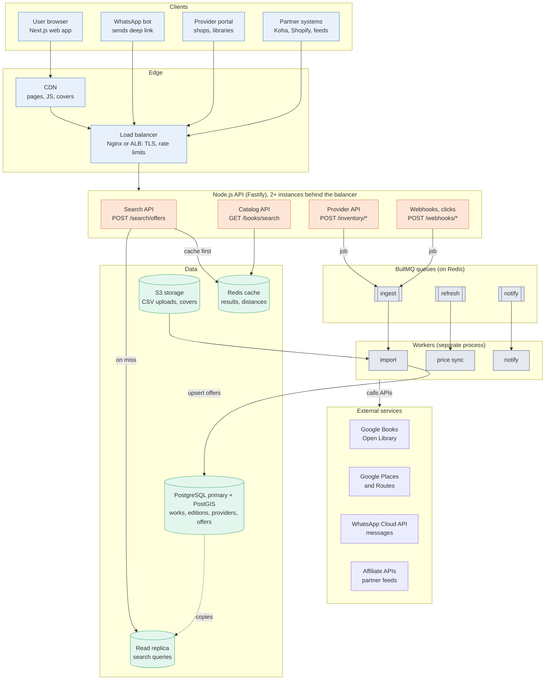

## BookNearBuy 

**Find your book. Compare every option. Get it nearby.**

BookNear is a location-aware, multi-provider book discovery and price comparison platform.
A user who already knows which book they want searches once, by title, author or ISBN, and sees
the **nearest and cheapest** ways to get it: borrow from a library, buy new or used from a local
bookstore or stall, or buy or rent online. Selecting an option redirects the user to that provider.

> BookNear is **not** an e-commerce store. It never handles payments, orders or delivery.
> It only **discovers, compares and redirects**.

**Status:**  Architecture and system design complete; implementation in progress.

---

##  Key features

- **One search, every channel:** libraries, bookstores, book stalls, online new and used sellers, rental providers
- **Exact edition matching:** ISBN first, with title and author as a fallback
- **Nearest-first ranking:** PostGIS distance bands, then price, then data freshness; online offers ranked separately by total delivered price
- **Honest data:** every offer shows when it was last updated; stale offers are labelled or hidden
- **Four ways for providers to send data:** API pull, webhooks, CSV/Excel upload, merchant dashboard
- **Click-out tracking:** validated redirects with referral analytics
- **WhatsApp entry point:** the book-recommendation bot sends "Get this book here" deep links

##  Architecture

The app is a **modular monolith** with **separate background workers**. The search path and the data-ingestion path share only the database.

| Path | Flow |
|---|---|
| **Search (sync, fast)** | Next.js → ALB → NestJS API → Redis cache → PostgreSQL + PostGIS → ranking → top 10–15 results → 302 redirect |
| **Ingestion (async)** | Provider webhook / CSV to S3 / EventBridge schedule → SQS → workers → validate, match ISBN, merge → PostgreSQL → cache invalidation |

**Workers**
- **Import Worker:** processes CSV/Excel uploads from S3 and returns a per-row error report
- **Inventory Worker:** applies webhook events (price, stock, availability) idempotently
- **Sync Worker:** pulls authorized provider APIs and feeds on a schedule
- Failed jobs retry, then go to an SQS dead-letter queue

### Architecture

### Component view



**How to read it:** search requests check Redis first and query the read replica only on a cache miss.
Provider uploads and webhooks become jobs on the `ingest` queue. Workers validate the data, match ISBNs and
upsert offers into the PostgreSQL primary, which copies to the read replica.

##  Tech stack

| Layer | Technology |
|---|---|
| Frontend | Next.js, React, TypeScript, Tailwind CSS |
| Backend | Node.js, NestJS + Fastify, REST |
| Database | Amazon RDS PostgreSQL + PostGIS |
| Cache | Amazon ElastiCache (Redis) |
| Async | Amazon SQS + DLQ, EventBridge Scheduler, ECS Fargate workers |
| Storage | Amazon S3 (presigned uploads) |
| Edge | Route 53, CloudFront, AWS WAF, Application Load Balancer |
| Ops | ECR, Secrets Manager, IAM, CloudWatch |
| External | Google Books, Open Library, Google Maps/Places, authorized marketplace APIs |

## 🔌 Main API endpoints

```http
GET    /api/v1/books/search?q={query}
GET    /api/v1/books/{bookId}/offers?lat={lat}&lng={lng}
POST   /api/v1/search/compare
POST   /api/v1/redirect/{offerId}
POST   /api/v1/providers/inventory
POST   /api/v1/providers/inventory/bulk-upload
GET    /api/v1/providers/inventory/import-status/{jobId}
POST   /api/v1/webhooks/{providerCode}
```

##  Planned structure

```text
booknear/
├── frontend/        # Next.js web app + provider portal
├── backend/         # NestJS API (modular monolith)
├── workers/         # SQS consumers: import, inventory, sync
├── packages/        # shared types and API contracts
├── infra/           # Docker and AWS config
└── docs/            # architecture diagrams, API reference
```

##  Roadmap

- [ ] Book catalog and search (Google Books, Open Library)
- [ ] Provider portal, CSV import and PostGIS nearby search
- [ ] Ranking engine, compare page and redirect tracking
- [ ] Webhooks, scheduled sync, online seller integrations
- [ ] Pilot in Nagpur, then top 10 Indian metros

## 👤 Author

**Prashant Bhushan**: B.Tech, NIT Nagpur · [GitHub](https://github.com/PrashantBhushan-repo)
